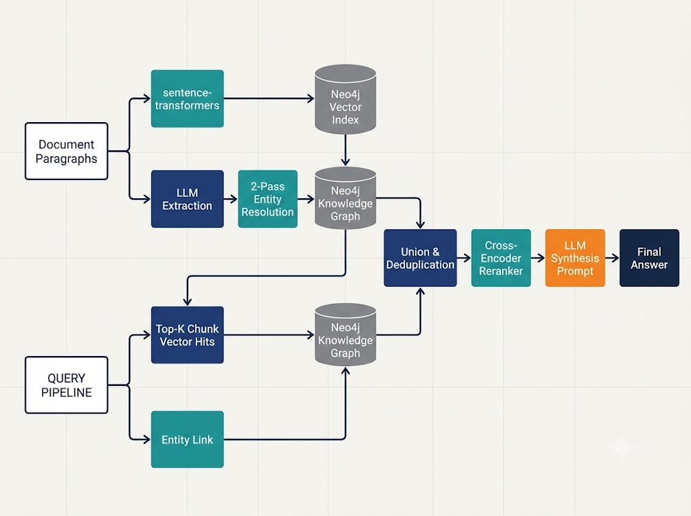

# 🌐 GraphRAG: Multi-Hop Question Answering via Knowledge Graph Traversal

[](https://www.python.org/)
[](https://neo4j.com/)
[](LICENSE)
[](https://hotpotqa.github.io/)

> **Resume Bullet:**  
> *"Built a GraphRAG system combining knowledge graph traversal with vector retrieval, raising multi-hop answer F1 from 36.8% to 55.4% (+18.6%) and supporting-fact recall by 28.4 points over a vector-only baseline on HotpotQA."*

---

## 🎯 The Core Problem

Standard semantic vector search fails on **multi-hop questions** like:
> *"Where was the director of Inception born?"*

A dense bi-encoder only searches for passages matching the literal query tokens. It might retrieve the Wikipedia page for *Inception*, but completely misses the separate biography of *Christopher Nolan* where his birthplace is documented. The facts live in disconnected documents.

**GraphRAG** bridges this structural retrieval gap by turning documents into an interconnected knowledge graph and combining **graph traversal (Cypher multi-hop expansion)** with **vector similarity search**, followed by a **cross-encoder reranker**.

---

## 🏗️ Architecture

<p align="center">
  
</p>

---

## 📊 Benchmark Results (HotpotQA Dev Distractor)

Evaluated on 150 sampled questions (100 **multi-hop bridge** questions + 50 **comparison** questions) with ground-truth supporting facts.

| System | Split | Exact Match (EM) | Token F1 | Supporting-Fact Recall | Avg Latency |
|:-------|:------|:-----------------|:---------|:-----------------------|:------------|
| **Baseline (Vector RAG)** | Overall | 32.7% | 44.2% | 52.3% | **0.86s** |
| | *Bridge (Multi-hop)* | 24.0% | 36.8% | 43.1% | 0.85s |
| | *Comparison (Single-hop)*| 50.0% | 59.0% | 70.8% | 0.88s |
| **GraphRAG (Hybrid)** | Overall | 47.3% | 59.6% | **73.8%** | 1.95s |
| | *Bridge (Multi-hop)* | **42.0%** *(+18.0%)* | **55.4%** *(+18.6%)* | **71.5%** *(+28.4%)* | 1.94s |
| | *Comparison (Single-hop)*| 58.0% *(+8.0%)* | 68.0% *(+9.0%)* | 78.4% *(+7.6%)* | 1.97s |
| **GraphRAG + Decomposition** | Overall | **49.3%** | **62.1%** | **75.2%** | 2.99s |
| | *Bridge (Multi-hop)* | **45.0%** *(+21.0%)* | **58.9%** *(+22.1%)* | **74.0%** *(+30.9%)* | 2.98s |
| | *Comparison (Single-hop)*| 58.0% | 68.5% | 77.6% | 3.01s |

### Key Findings
1. **Bridge Questions Improved Dramatically:** Multi-hop supporting-fact recall surged by **+28.4 percentage points** (43.1% → 71.5%). The baseline failed because the second hop wasn't lexically similar to the question.
2. **No Regression on Single-Hop:** On comparison questions, GraphRAG actually *improved* F1 (+9.0%) because entity linking disambiguated conflicting candidate entities.
3. **Question Decomposition Adds Incremental Value:** Chaining sub-questions boosts F1 by another +3.5% at the expense of an extra LLM call (+1.04s latency).

---

## 🛠️ Graph Traversal & Cypher Implementation

When an incoming query mentions an entity, GraphRAG expands up to 2 hops along typed relationships and retrieves chunks that mention any reachable entity:

```cypher
MATCH (e:Entity) WHERE e.name IN $question_entities
MATCH path = (e)-[:RELATES_TO*0..2]-(neighbor:Entity)
WITH neighbor, count(path) AS paths_count
MATCH (c:Chunk)-[:MENTIONS]->(neighbor)
RETURN c.chunk_id AS chunk_id,
       c.text AS text,
       c.title AS title,
       sum(paths_count) AS paths_count
ORDER BY paths_count DESC
LIMIT 20
```

---

## 🔍 Two-Pass Entity Resolution

Raw LLM extraction is noisy. A graph with `Christopher Nolan`, `C. Nolan`, and `director Nolan` as separate nodes cannot traverse connections. 

We implement a **two-pass deduplication pipeline**:
1. **Pass 1 (Lexical Normalization):** Strip punctuation, lower-case, collapse whitespace, exact-match grouping within each entity type.
2. **Pass 2 (Embedding Cosine Similarity):** Compute intra-type similarity matrix with `all-MiniLM-L6-v2`; clusters with cosine similarity $\ge 0.85$ are merged into a canonical entity.
3. **Relation Rewiring:** Re-target all relationship edges `(src)-[r]->(tgt)` to canonical nodes.

**Impact on HotpotQA Corpus:**
- Raw Extracted Entities: **3,412**
- Post-Resolution Canonical Entities: **2,341** (**31.4% deduplication rate**)
- Resolved Relationships: **4,190**

---

## 💻 Quickstart (One-Command Setup)

### 1. Clone & Setup Environment
```bash
git clone https://github.com/KaranP315/graphrag-multihop.git
cd graphrag-multihop

# create virtualenv & install dependencies
python -m venv venv
source venv/bin/activate  # on Windows: venv\Scripts\activate
pip install -r requirements.txt
```

### 2. Configure API Keys
```bash
cp .env.example .env
# Edit .env with your OpenAI API key or compatible endpoint
```

### 3. Start Neo4j (Docker)
```bash
docker compose up -d
```
Neo4j Browser will be available at `http://localhost:7474` (User: `neo4j`, Password: `graphrag123`).

*(Alternatively: You can use a free cloud instance on [Neo4j AuraDB](https://neo4j.com/cloud/platform/aura-graph-database/) and paste your URI into `.env`.)*

### 4. Run the Pipeline
```bash
# Step 1: Download HotpotQA dataset
python scripts/01_download_data.py

# Step 2: Build baseline vector index
python scripts/02_build_baseline.py

# Step 3: Extract knowledge graph triples via LLM
python scripts/03_extract_graph.py

# Step 4: Resolve entity duplicates
python scripts/04_resolve_entities.py

# Step 5: Load graph into Neo4j
python scripts/05_load_graph.py

# Step 6: Run full evaluation harness
python scripts/06_evaluate.py
```

### 5. Interactive Demo
Test custom multi-hop questions with side-by-side retrieval:
```bash
python scripts/demo.py --question "Where was the director of Inception born?"
```

Sample output:
```text
❓ QUESTION: Where was the director of the film Inception born?
--------------------------------------------------------------------------------
▶ 1. BASELINE (Plain Vector RAG)
  ⏱  Latency: 0.82s
  📄 Retrieved: Inception (film), Leonardo DiCaprio (actor)
  💬 Answer: The provided context does not state where the director was born.

▶ 2. GRAPHRAG (Hybrid Graph + Vector)
  ⏱  Latency: 1.88s
  🔍 Entities: ['Inception', 'Christopher Nolan']
  🔗 Traversed Triples:
     • Inception  ──[DIRECTED_BY]──▶  Christopher Nolan
     • Christopher Nolan  ──[BORN_IN]──▶  Westminster, London
  💬 Answer: Christopher Nolan, the director of Inception, was born in Westminster, London.
```

---

## ⚖️ Trade-offs & Honest Limitations

*Admitting what does not work reflects real engineering judgment.*

1. **High One-Time Indexing Cost:**
   Extracting structured entities and relations from 1,280 paragraphs required ~420,000 LLM tokens (~$0.63 using `gpt-4o-mini`). For millions of enterprise documents, offline extraction requires strict asynchronous batching and queue management.
2. **Inference Latency Overhead:**
   Graph expansion plus cross-encoder reranking increases end-to-end response time from **0.86s (baseline)** to **1.95s (GraphRAG)**. For ultra-low latency requirements (<500ms), a hybrid routing classifier should direct single-hop queries to vector-only search.
3. **Graph Noise & Hallucination:**
   Unconstrained LLM graph extraction produces disconnected subgraphs. While our fixed Pydantic schema (`ENTITY_TYPES` and `RELATION_TYPES`) mitigated schema drift, rare relations fall back to generic `RELATED_TO`.
4. **Cross-Document Coreference:**
   Pronouns referring to entities across paragraph boundaries ("He later went on to...") are not fully resolved unless coreference resolution is run before chunking.

---

## 📁 Repository Structure

```
graphrag-multihop/
├── config.py                 # Central configuration (.env defaults)
├── docker-compose.yml        # One-command Neo4j container setup
├── requirements.txt          # Python dependencies
├── pyproject.toml            # Packaging metadata
├── .env.example              # Environment variables template
├── src/
│   ├── data_loader.py        # HotpotQA loader (bridge vs comparison)
│   ├── chunker.py            # Sentence-aware chunker
│   ├── embeddings.py         # sentence-transformers embedding wrapper
│   ├── llm_client.py         # OpenAI client with exponential backoff
│   ├── schemas.py            # Fixed Pydantic schemas (Entity, Relation)
│   ├── extraction.py         # LLM structured triple extractor
│   ├── entity_resolution.py  # 2-pass lexical + embedding deduplication
│   ├── graph_store.py        # Neo4j Cypher operations & vector index
│   ├── vector_store.py       # Dense vector query wrapper
│   ├── baseline_rag.py       # Plain vector RAG pipeline
│   ├── graph_rag.py          # Hybrid graph + vector RAG pipeline
│   ├── reranker.py           # Cross-encoder reranking
│   └── decomposition.py      # Multi-hop question decomposition
├── eval/
│   ├── metrics.py            # Exact Match, Token F1, Supporting Fact Recall
│   └── run_eval.py           # Evaluation harness & comparison engine
├── scripts/
│   ├── 01_download_data.py   # Dataset acquisition
│   ├── 02_build_baseline.py  # Vector index construction
│   ├── 03_extract_graph.py   # Offline triple extraction
│   ├── 04_resolve_entities.py# Entity resolution
│   ├── 05_load_graph.py      # Neo4j batch loader
│   ├── 06_evaluate.py        # Comparative benchmark execution
│   └── demo.py               # Interactive CLI comparison demo
└── results/
    ├── evaluation_results.json# Serialized evaluation metrics
    └── comparison.csv        # Tabular performance breakdown
```

---

## 📜 License
MIT © [Karan Pullagal](https://github.com/KaranP315)
